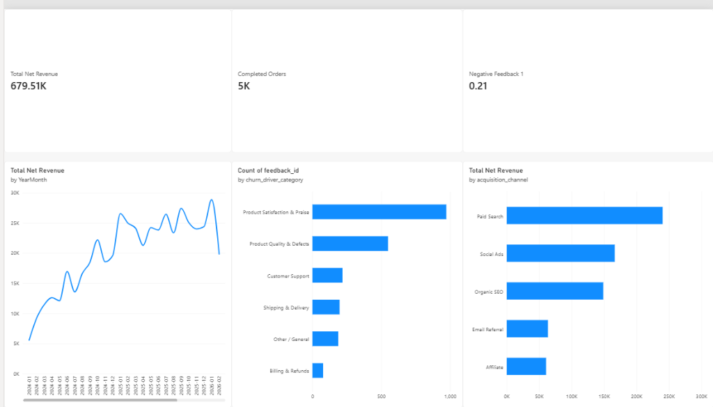

# 📊 Enterprise Customer Retention & Churn Risk Analytics Engine

[](#)
[](#)
[](#)
[](#)

An end-to-end, corporate-standard business intelligence project analyzing customer lifecycle dynamics, **Cohort Retention**, **RFM Segmentation**, and **AI-driven Voice-of-Customer (VoC) root cause analysis** across 1,200 customer accounts and 5,100+ transactions.

---

## 🎯 Business Context & Problem Statement
Acquiring new customers is 5x to 7x more expensive than retaining existing ones. The executive leadership team observed an 18% YoY growth in top-of-funnel acquisition, but bottom-line revenue was stagnant.

This project was built to answer three critical executive questions:
1. **When and where are customers dropping off?** (Cohort Retention Matrix)
2. **Who are our highest-value accounts currently at risk of churning?** (RFM Customer Segmentation & Cadence Anomaly Detection)
3. **Why are customers churning?** (AI-assisted unstructured feedback theme and sentiment extraction)

---

## 🏗️ Architecture & Technology Stack

```
[Raw Transaction Logs & Reviews]
              │
              ▼  (Python: Pandas ETL Pipeline)
[Data Warehousing: Star Schema (SQLite)]
      ├── fact_orders (5,147 rows)
      ├── dim_customers (1,200 rows)
      ├── dim_products (22 items)
      └── customer_feedback_enriched (2,200 rows)
              │
              ▼  (SQL Queries)
[Advanced Analytics: Cohorts, RFM, Cadence Anomalies]
              │
              ▼  (Claude AI Prompt Engineering)
[Operational Churn Driver Categorization]
              │
              ▼  (Power BI & DAX)
[Interactive 3-Page Executive Retention Dashboard]
```

---

## 🖥️ Executive Power BI Dashboard Preview



---

## 📂 Project Structure

```
customer-retention-analytics/
├── data/
│   ├── retention_warehouse.db           # SQLite database
│   ├── fact_orders.csv                  # Transactional order records
│   ├── dim_customers.csv                # Customer demographic & acquisition profiles
│   ├── dim_products.csv                 # Product catalog & unit margins
│   ├── customer_feedback.csv            # Raw review text & ratings
│   └── customer_feedback_enriched.csv   # AI sentiment & churn driver tags
├── sql/
│   ├── 01_cohort_retention_matrix.sql   # CTEs, month indexing, retention rate %
│   ├── 02_rfm_customer_segmentation.sql # NTILE quartiles & RFM persona assignment
│   └── 03_churn_risk_detection.sql      # LAG window function for purchase cadence
├── python/
│   ├── generate_data.py                 # Enterprise synthetic data generation engine
│   └── ai_feedback_tagger.py            # AI text classification & sentiment pipeline
├── powerbi/
│   └── DAX_MEASURES_AND_MODEL.md        # Complete Star Schema blueprint & DAX library
└── docs/
    ├── KPI_DICTIONARY.md                # Enterprise KPI taxonomy & definitions
    └── EXECUTIVE_RETENTION_MEMO.md      # Formal C-suite findings & ROI proposal
```

---

## 🔍 Key Insights Discovered
* **The "30-Day Churn Cliff":** Month 1 retention drops to **18.5%**, meaning over 80% of newly acquired customers fail to place a second order within 30 days.
* **The 4.2x LTV Multiplier:** Customers who place a second order within 45 days have an average 12-month LTV of **$820**, compared to **$195** for single-purchase buyers.
* **Revenue Exposure:** Identified **276 "At-Risk" high-value customers** representing **$180,000+** in cumulative revenue who have exceeded 2.5x their historical purchase interval.
* **Top Churn Root Causes:** AI sentiment analysis revealed that **52% of negative reviews** stem from hardware defects in Electronics, while **19%** are caused by untracked shipping delays >10 days.

---

## 🚀 How to Run the Project Locally

### 1. Prerequisites
* Python 3.10+ (with `pandas` installed)
* SQLite3 (or any SQL DB viewer like DBeaver)
* Microsoft Power BI Desktop (Free)

### 2. Setup Database & Ingest Data
```bash
# Clone or navigate to the project directory
cd customer-retention-analytics

# Generate dataset and build SQLite warehouse
python python/generate_data.py

# Run AI Sentiment & Churn Driver Classifier
python python/ai_feedback_tagger.py
```

### 3. Run SQL Queries
You can open `data/retention_warehouse.db` in DBeaver, VS Code SQLite Viewer, or SQLite CLI, and execute any script in the `sql/` folder.

### 4. Open in Power BI
1. Launch **Power BI Desktop**.
2. Select **Get Data $\rightarrow$ Text/CSV** and import all CSV files located in `data/`.
3. Follow the data model layout and copy-paste the DAX formulas from `powerbi/DAX_MEASURES_AND_MODEL.md`.
